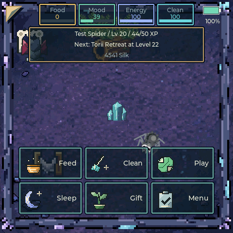

# Spidarium

A virtual jumping-spider vivarium on a Waveshare **ESP32-S3-Touch-AMOLED-2.16**.

480×480 AMOLED, 16 MB flash, 8 MB octal PSRAM, ESP-IDF v5.5.6, LVGL 9.6.

You keep a spider. It wanders, hunts, sleeps, moults and gets sick if you neglect
it. You feed it by slingshotting it at bugs, clean the tank, play with it, and
give it gifts. It remembers all of it across reboots.

**[Website, web flasher and simulator](https://jeromedontdev.github.io/Spidarium/)**
| **[Download v1.1.17](https://github.com/jeromedontdev/Spidarium/releases/tag/v1.1.17)**
| [Screenshots and feature guide](docs/README.md)



---

## What makes it interesting

**A quieter habitat.** Soft air and leaf textures fade in and out behind the
action, without automatic chirps or falling pitch sweeps. Pounce is a short
noise whoosh. Browser and device share the same seeded ambience PCM, with
working volume/mute and prompt foreground interruption.
See [v1.1.17 release notes](docs/RELEASE_v1.1.17.md).

**The spider is one canvas, not a scene graph.** It is drawn from scratch into a
single 96×96 RGB565A8 buffer every frame — legs, body, fuzz, eyes, fangs, gait,
squash/stretch.

**Pixels are written directly.** `cspider.c` does not call `lv_draw_rect()` or
`lv_draw_line()`. Going through LVGL's draw layer made the software renderer
allocate temporary blending buffers for every primitive every frame; those came
out of internal DMA RAM and starved the LCD after about thirty seconds.

**The radio is on only for bounded jobs.** A worker pauses the whole display
adapter with acknowledgement, drains persistence, scans/connects/synchronizes
or downloads an update, then stops and deinitializes WiFi on every exit.
Boot sync happens only with saved credentials. Fresh NTP UTC sets the external
RTC; its backup power keeps time while the device is off.

**Eighteen gifts and consistent artwork.** All gift bonuses have gameplay
consumers. Non-spider art follows a deterministic pixel-art generator and
[style contract](docs/ART_STYLE.md); existing spider art is preserved.
See [asset maintenance](assets/README.md).

**Hunting gets the whole enclosure.** A translucent top-left page ear reveals
centered compact status boxes along the top row, plus Feed/Clean/Play/Sleep/Gift/Menu
actions. Tapping the ear again or an empty tank tap closes the overlay without firing;
choosing a gift exposes placement with an X icon to cancel.
Sleep is a real toggle: the button reads **Wake** while the spider is asleep, and
a sleep you asked for holds until energy is actually full rather than ending at a
fixed threshold, so pressing it always has a visible payoff.
Drag toward a bug to jump; AI and prey hold still during the gesture.
Rounded silk-bordered cards use visibly disabled Prev/Next paging rather than
slow scrolling. Only Back navigates back; blank taps are ignored. The QWERTY
keyboard includes WiFi Show/Hide
password. Sixteen authored top-down enclosure scenes are **ground texture only**:
an earth, stone or gravel substrate with a worn trail and fine grit, composed at
the panel's native 240x240 with a full colour ramp rather than quantised to a
retro palette. Everything that sits on the floor is placeable decor instead.
Bent legs have visible knee joints.
The selected enclosure survives reboot. Eight prey species unlock at levels
1/2/4/6/10/13/16/20; existing pet progress is preserved. Distance-driven,
alternating leg motion keeps front joints forward regardless of render cadence.
See [UI details](docs/MENU_ARCHITECTURE.md).

**Play is a random minigame.** Bug Hunt, Color Match and Quick Tap use big
touch targets and eight increasingly difficult rounds, with no immediate repeat.
Bug targets shift, colors test memory and Quick Tap has false cues.
Completion pays score-based XP and Silk; Back cancels without care rewards. Care shows XP and the next
unlock, hunting pays more XP, and existing level/save progress is preserved.
Care buttons and menu cards are taller; Wipe Spider is red and is always the last
Settings row, behind its confirmation screen.

**Gifts are earned habitat furniture.** Buy with Silk from games/hunts, then
reposition owned items for free. Larger 64px shelters/perches/toys have explicit
purposes, unlocks through level 40 and visible spider visits. Existing placed
gifts and pet progress survive the save migration.
See [the gift shop](docs/GIFTS_CATALOG.md).

**Decor is the enclosure you arrange.** Sixteen kinds — rocks, pebbles, a log, a
bark slab, a fern, moss, a succulent, two flowers, a mushroom, a shell, a
crystal, a leaf pile, a twig and a bone — are bought with Silk (12–68) and
unlock from level 1 to 9. Pick one in the Decor menu, tap the tank to place it,
and twelve slots hold the result. Each item is either **blocking** or
**non-blocking**: the spider steers around a blocking item before it reaches it,
and walks straight over a non-blocking one. Blocking is a steering input, not a
positional shove, so the spider turns away instead of grinding against a rock.
**Hold a finger on a placed item** to open its menu, where you can flip the
blocking flag, move it, or put it away. The catalogue order is shared with the
browser port and checked by a test that parses the C table.

**A daily loop, and treats to spend Silk on.** Each in-game day offers a check-in
whose reward grows with a consecutive-day streak (6 XP / 4 Silk on day one, up to
18 XP / 16 Silk at a seven-day cap; missing a day resets it), plus one rotating
task — catch three prey, clean twice, play three times or pet four times — worth
a flat 12 XP and 8 Silk. Gifts are one-time purchases, so once all eighteen were
owned Silk had nothing left to buy; treats are consumables that cost Silk every
time (Juicy Fly 6, Silk Ribbon 8, Warm Pebble 10) and give a short, visible
boost. The day prefers the RTC, so the check-in resets at midnight; when the RTC
is not valid it falls back to the in-game day counter, so the loop still works on
a board with no RTC battery and no WiFi sync.
See [v1.1.12 release notes](docs/RELEASE_v1.1.12.md).

**Petting is back.** A tap that lands on the spider raises mood and bond, plays a
short bounce with a happy leg wave, and pays XP — but only for the first 10 XP of
each in-game day, so a bored thumb cannot farm levels. A 1.2 s cooldown refuses a
repeat, and a pull that starts on the spider still fires, because a click only
arrives when the finger did not drag.

**Battery-aware display.** Real AXP2101 battery/USB/charging telemetry,
a 10..100% brightness slider, a heuristic runtime estimate, screen rotation,
idle dimming, screen-off/touch wake and low-battery
save/dimming are implemented without changing the charger configuration.
Battery and Display are separate Settings menus.
See [battery management](docs/BATTERY_MANAGEMENT.md).
The unboxed upper-right gauge appears only with the care HUD, below the identity
panel inside the display's safe area. It shows level/charging and opens voltage details on tap.
Name and next unlock share a translucent reading panel. Feed disables at three
live bugs, so it cannot be tapped for free XP. Clean is never disabled: it pays
XP in proportion to how much the tank actually improved, so a spotless tank pays
nothing and repeated taps cannot farm it. Achievement badges are distinct and
every species has splatter art.
Sound controls live under Settings.

**Playfield screenshots.** Settings > Save Screenshot writes a numbered,
verified BMP to SD without menus or HUD. The browser downloads a playfield PNG.
Serial captures can include menus or isolate the playfield for agent diagnostics;
see [screenshot commands](docs/serial_console.md#screen-capture).

**Manual care by default.** Settings has one Auto Feed switch, off for new and
migrated saves, that drives both wild prey and unattended hunting. Without it,
Feed adds prey
and dragging/releasing the spider aims and pounces; autonomous wandering and
gift visits continue. These options are persisted in pet backups.

**Browser tools, without an account.** Install the official firmware over Web
Serial, download/view/restore a pet backup, or send WiFi settings directly to
your device. No passwords are stored by the website. Try the playable browser
simulator separately; it is a model of the game, not native firmware emulation.
See [website development](site/README.md) and [release notes](docs/RELEASE_v1.1.1.md).

The browser uses the device-coordinate UI at a larger responsive size, with
fullscreen and local progress/backup. Its hardware menus clearly redirect to
real USB tools rather than pretending to have a WiFi radio, SD card or PMIC.

## License

Free for personal, non-commercial use under the [published license](LICENSE).
Commercial use needs separate written permission. This is source-available,
not OSI open source. Third-party components retain their own licenses.

**PSRAM and task ownership apply throughout the game.** CPU-only buffers, TLS,
audio/console and main LVGL stacks use PSRAM. Network/persistence stacks remain
internal because flash operations disable caches. Audio, persistence and SD
operations use copied-job worker queues. Only LVGL's task mutates its objects.
See [the design policy](docs/PSRAM_THREADING_ARCHITECTURE.md).

**Core actions are drivable over serial.** Care actions, menu/editor opens,
network jobs and diagnostics can be exercised from scripts. Physical appearance
and touchscreen ergonomics still need board-level inspection.

---

## Hardware

| | |
|---|---|
| Board | Waveshare ESP32-S3-Touch-AMOLED-2.16 |
| Display | 480×480 AMOLED (CO5300), SPI |
| Touch | CST9217, I²C |
| Flash | 16 MB |
| PSRAM | 8 MB octal @ 80 MHz |
| Audio | ES8311 codec, I²S |
| RTC | PCF85063A, I²C address 0x51, UTC calendar |

---

## Build

Requires ESP-IDF v5.5.6.
The release pins Waveshare BSP 2.0.1 and LVGL 9.6.0~1 and commits
`dependencies.lock` for repeatable component resolution.

```powershell
powershell -File build.ps1 *> build_out.txt 2>&1
powershell -File flash.ps1 COM7
```

`build.ps1` and `flash.ps1` are thin wrappers around `idf.py` that set up the
environment. Use them rather than calling `idf.py` directly.

### First build

`sdkconfig` is **not** committed — it is generated from `sdkconfig.defaults` on
the first build. That file carries every setting the project needs, including the
ones that are easy to lose:

- `CONFIG_SPIRAM_TRY_ALLOCATE_WIFI_LWIP=y` — prefers PSRAM for eligible network
  buffers; hardware-required internal buffers still exist
- `CONFIG_LV_USE_CANVAS=y` and `CONFIG_LV_DRAW_SW_SUPPORT_RGB565A8=y` — the
  renderer does not work without them
- `CONFIG_SPIRAM_MALLOC_ALWAYSINTERNAL=0` — prefers PSRAM for ordinary malloc
- `CONFIG_SPIRAM_MALLOC_RESERVE_INTERNAL=65536` — reserves internal memory for
  capability-specific allocations, including hardware radio/DMA consumers
- `CONFIG_MBEDTLS_EXTERNAL_MEM_ALLOC=y` — TLS allocations use PSRAM

**A setting that exists only in `sdkconfig.defaults` is not applied until
`sdkconfig` is regenerated.** Change both the active file and defaults, then
verify the generated header. Do not delete the active configuration casually.

### OTA migration and use

The partition table now has three 3 MB app regions (factory plus two OTA slots),
OTA metadata and 6 MB assets. Initial migration requires the full flash wrapper,
not an application-only update. NVS/PHY offsets are preserved.

Settings > WiFi supports scans, secure-network passwords, manual SSID,
three saved networks, explicit time sync, forget and a manual HTTPS update URL.
Credentials are saved after successful association; WiFi does not stay connected.
No production update server is configured. OTA validates HTTPS, project identity
and image completion, then requires a reboot to apply. It does not provide a
signed release manifest, semantic downgrade prevention or functional rollback.
See [network details and verification limits](docs/WIFI_ARCHITECTURE.md).

---

## Test

The device has a serial command console. This is the primary way to verify a
change — not tapping the screen.

```powershell
python cmd.py COM7 "help"
python cmd.py COM7 "mem"
python cmd.py COM7 "scan"
python cmd.py COM7 "scanloop 5"
python cmd.py COM7 "render 500"
python cmd.py COM7 "open wifi"
python cmd.py COM7 "set hunger 5"
```

Run the whole suite:

```powershell
python run_tests.py COM7
```

Soak the device and check for faults:

```powershell
& 'C:\Espressif\python_env\idf5.5_py3.11_env\Scripts\python.exe' stability_check.py COM7 40
```

Full command reference: **[docs/serial_console.md](docs/serial_console.md)**.

The two commands that matter most:

- **`scanloop N`** — runs N scans and fails if the largest free block drifts by
  more than 4 KB. Catches the radio leaking its DMA buffers.
- **`render N`** — runs N render ticks and fails on the same drift. Catches
  per-frame allocations in the renderer.

Both print memory before and after. A leak shows up as a number that keeps
falling, not as a corrupted screen thirty seconds later.

---

## Memory

**Watch `largest`, not `free`.** A fragmented pool reports plenty free and still
fails one contiguous DMA allocation. Framebuffers are in PSRAM, but SPI staging
still needs internal DMA-capable blocks. The acceptance target is `largest`
at least 51,200 bytes; see the latest [verification round](PROGRESS.md).

Where things live:

| Thing | Where | Why |
|---|---|---|
| LCD draw buffers | PSRAM | `use_psram = true`, 96,000 bytes |
| Code + rodata | PSRAM | `SPIRAM_FETCH_INSTRUCTIONS`, `SPIRAM_RODATA` |
| Spider canvas | PSRAM | CPU-only; 96×96 RGB565A8 = 27,648 bytes |
| Eligible WiFi/LwIP buffers | PSRAM preferred | Hardware buffers remain internal |
| Main LVGL, audio and console stacks | PSRAM | Explicit supported APIs |
| Network and save/SD stacks | internal | Required for cache-disabled flash operations |
| LVGL draw-worker stacks, task control blocks | internal | Platform allocation |
| TLS working buffers | PSRAM | `MBEDTLS_EXTERNAL_MEM_ALLOC` |

Full budget: **[docs/memory_budget.md](docs/memory_budget.md)**.

---

## Layout

```
main/
  main.c          BSP bring-up only
  game.c          orchestrator: timers, menus, tap handling, pause
  cspider.c       canvas spider renderer  ← the creature
  spider.c        slingshot aim visuals + setup preview
  behaviour.c     FSM: wander, stalk, aim, pounce, wall avoidance
  prey.c          bugs: spawn, flee, catch resolution
  needs.c         hunger/mood/energy/hygiene decay
  mind.c          intent layer
  gift.c          gift bonuses
  species.c       data-driven bug table
  theme.c         palettes
  decor.c         placeable decor catalogue, blocking, hit testing
  terrarium.c     ground texture, decor layer, droppings
  ui_hud.c        buttons, stat rings, emote derivation
  ui_menu.c       generic list menu
  ui_setup.c      first-run colour picker
  net.c           WiFi: scan, connect, credentials
  rtc.c           battery-backed UTC calendar
  sd.c            SD card backup/restore
  meminfo.c       memory reporting
  test_console.c  serial command interpreter
  save.c          NVS persistence
  audio.c         I2S codec
  assets.c        QOI sprite partition
```

### Timers

- `game_tick_logic` — 20 Hz. Needs, behaviour, prey, save, heartbeat.
- `game_tick_render` — 30 Hz. Terrarium, canvas, aim visuals, prey, HUD.

`game_tick_render` returns early while the radio is active, so the tank is not
drawn while the radio holds the DMA pool.

---

## The three rules

These are not style preferences. Each was learned by breaking the device.

### 1. Never block the LVGL task

It drives the display and has an **8 KB stack**. Blocking it freezes the UI and
the task watchdog reboots the device. Anything that can take longer than a frame
goes on a worker task. The UI polls; it never waits.

### 2. LVGL is not thread-safe

`lv_*` may only be called from the LVGL task. Cross-thread work is a **request
plus an acknowledgement**, never a direct call. This includes the serial console:
every command that touches the UI is marshalled onto the LVGL task.
### 3. Internal DMA RAM is the scarce resource

512 KB internal SRAM, of which the LCD SPI driver needs a large **contiguous**
block. 8 MB PSRAM is plentiful but **not DMA-capable for the LCD**. Anything
read and written only by the CPU belongs in PSRAM.

---

## Documentation

**Start here**: [docs/INDEX.md](docs/INDEX.md) — Master documentation index with quick navigation

### Core Manuals
- **[.github/copilot-instructions.md](.github/copilot-instructions.md)** — The three golden rules and operating constraints
- **[PROGRESS.md](PROGRESS.md)** — Every development round, with root causes and reasoning
- **[docs/serial_console.md](docs/serial_console.md)** — Every console command with examples
- **[docs/memory_budget.md](docs/memory_budget.md)** — Where every kilobyte of RAM goes

### Major Overhaul Documentation (NEW)
- **[IMPLEMENTATION_PLAN.md](IMPLEMENTATION_PLAN.md)** — Five-part roadmap: menu, WiFi, gifts, assets, docs
- **[docs/MENU_ARCHITECTURE.md](docs/MENU_ARCHITECTURE.md)** — Hierarchical menu system design
- **[docs/WIFI_ARCHITECTURE.md](docs/WIFI_ARCHITECTURE.md)** — WiFi state machine and user controls
- **[docs/GIFTS_CATALOG.md](docs/GIFTS_CATALOG.md)** — Complete gift catalogue (5→18 gifts)
- **[docs/ART_STYLE.md](docs/ART_STYLE.md)** — Visual design guide: colors, icons, sprites
- **[docs/ASSETS_INVENTORY.md](docs/ASSETS_INVENTORY.md)** — Asset status and creation priority
- **[docs/AGENT_HANDOFF.md](docs/AGENT_HANDOFF.md)** — Everything new agents need to know

---

## Status

Working: the spider, the hunt, needs and decay, gifts, achievements, themes,
first-run setup, save/restore, SD backup, WiFi scan, the serial console.

Planned: 
- **Menu System Overhaul** — Hierarchical menus with proper scrolling and styling
- **WiFi Settings** — User control: on/off toggle, multi-network support, manual selection
- **Gifts Expansion** — 5→18 unique gifts with unlock levels and special effects
- **Assets Refresh** — Professional-quality UI icons, prey sprites, decorations
- **Complete Documentation** — All architectural decisions documented for agent handoff

See **[IMPLEMENTATION_PLAN.md](IMPLEMENTATION_PLAN.md)** for the complete overhaul roadmap and [docs/INDEX.md](docs/INDEX.md) for documentation navigation.

---

## Credit

Inspired by [Pocket Tank](https://github.com/mediacutlet/pocket-tank) by
mediacutlet — a virtual pet on a small round display. Spidarium is an
independent implementation: a different creature, a different renderer, a
different save format and a different UI. Several of the hard-won lessons in
`PROGRESS.md` were relearned the slow way rather than copied.
