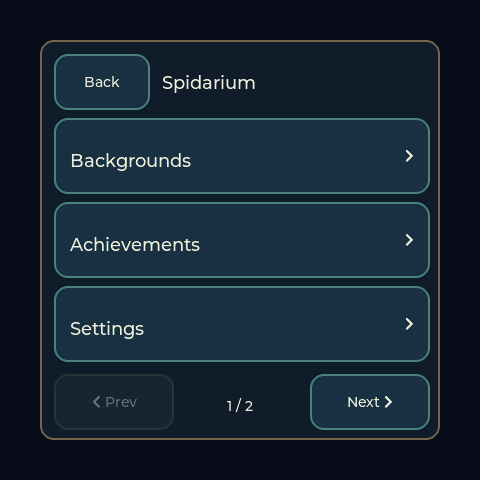
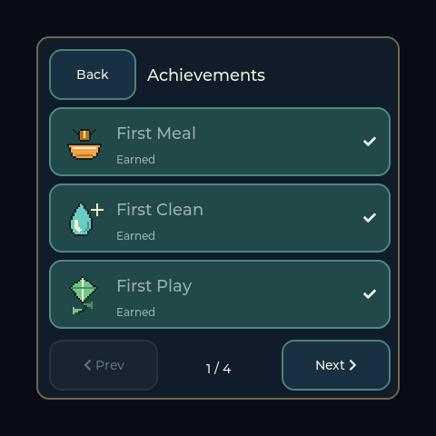

# Spidarium feature guide

[Website, browser tools and simulator](https://jeromedontdev.github.io/Spidarium/)
| [Official release](https://github.com/jeromedontdev/Spidarium/releases/tag/v1.0.0)
| [Complete documentation index](INDEX.md)

## Device screenshots

These are actual 480x480 LVGL screen captures from the connected board, not
design mockups. The screenshot command copies a one-off RGB565 snapshot on
LVGL and transfers its rows on the serial task; it is not part of rendering.
Captured pet values can differ because the existing pet continues normal play.

| Care HUD | Menu |
|---|---|
|  |  |



## Play and progression

- Drag from the spider toward a bug to pounce; held gestures freeze prey/AI.
- Feed adds a live bug only when fewer than three are present. A disabled Feed
  button means catch one first; Clean also frees the tank.
- Play chooses an eight-round minigame with ramped difficulty. Completed games
  and hunts earn XP and Silk. Cancelled games do not pay rewards.
- Buy one of eighteen habitat gifts after meeting its level and Silk price;
  owned placement is free. The spider visits equipped furniture.
- Unlock eight prey species, track ten achievements and keep the pet healthy.

## Controls and settings

The top-left fold reveals care controls. Name/XP, next unlock and wallet have
a translucent reading panel; battery remains in the top-right corner. Its fill
and percentage represent charge, a bolt represents charging, and tapping it
opens voltage/power/brightness details. Unknown readings are not fabricated.

Backgrounds, Achievements, Settings and Prey Species are on the main menu.
Sound belongs in Settings alongside WiFi, SD, About, Battery and Display and
the red, confirmed New Tank action. Only Back goes back. Prev/Next remain visible
but gray and inert at page boundaries.

## Maintain and verify

- [Build/handoff](AGENT_HANDOFF.md)
- [Serial console and browser protocol](serial_console.md)
- [Menu/HUD design](MENU_ARCHITECTURE.md)
- [Gifts](GIFTS_CATALOG.md), [battery](BATTERY_MANAGEMENT.md), [network](WIFI_ARCHITECTURE.md)
- [Art authoring](ART_STYLE.md), [inventory](ASSETS_INVENTORY.md)
- [Release verification](RELEASE_VERIFICATION.md)

Capture an actual device screenshot without modifying the pet:

```powershell
& 'C:\Espressif\python_env\idf5.5_py3.11_env\Scripts\python.exe' tools\capture_screen.py COM7 docs\screenshots\device-hud.png --menu chrome
```
