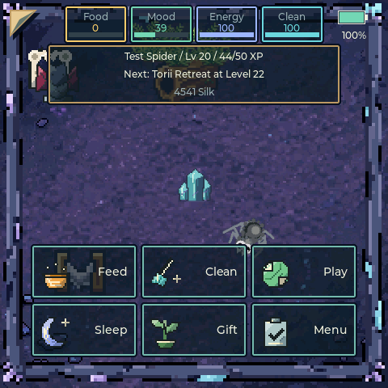
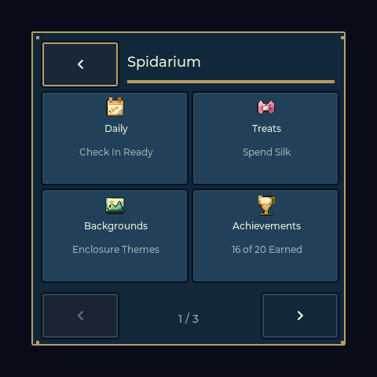
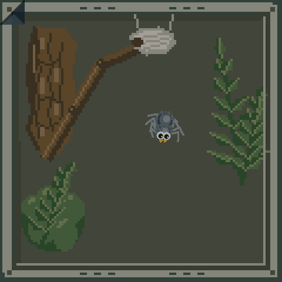
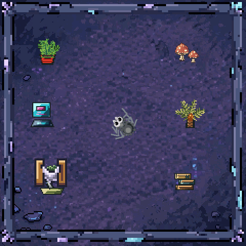
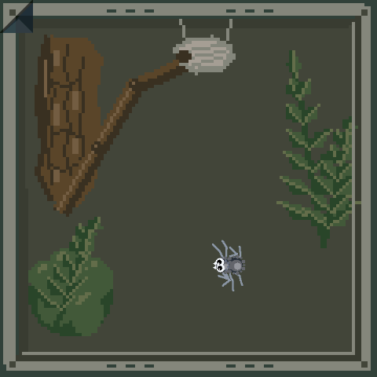
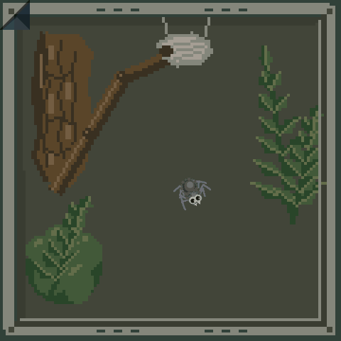
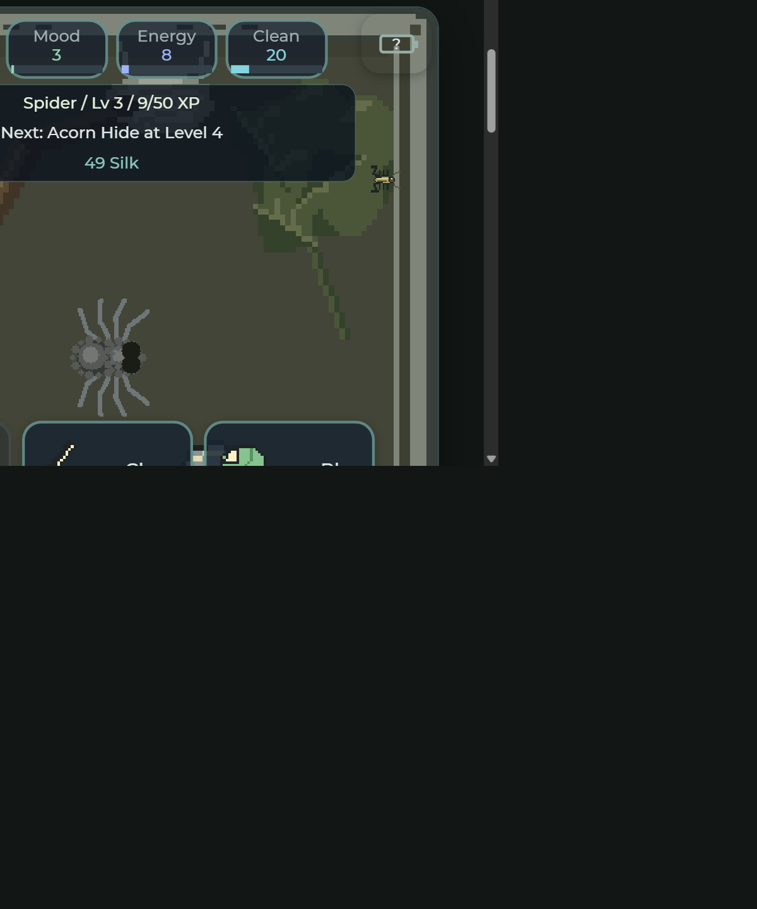

# Spidarium feature guide

[Website, browser tools and simulator](https://jeromedontdev.github.io/Spidarium/)
| [Official release](https://github.com/jeromedontdev/Spidarium/releases/tag/v1.1.0)
| [Complete documentation index](INDEX.md)

## Device screenshots

These are actual 480x480 LVGL screen captures from the connected board, not
design mockups. The screenshot command copies a one-off RGB565 snapshot on
LVGL and transfers its rows on the serial task; it is not part of rendering.
Captured pet values can differ because the existing pet continues normal play.

| Care HUD | Main menu |
|---|---|
|  |  |

| Settings | Playfield |
|---|---|
|  |  |

| Battery | Display |
|---|---|
|  |  |

| Sound | Menu cards |
|---|---|
|  |  |

## Play and progression

- Drag from the spider toward a bug to pounce; held gestures freeze prey/AI.
- Feed adds a live bug only when fewer than three are present. A disabled Feed
  button means catch one first; Clean also frees the tank.
- Play chooses an eight-round minigame with ramped difficulty. Bug Hunt shuffles
  the target every 1.5 s (easing to ~1 s) and shuffles the decoy species too;
  Color Match shows a colour sequence to repeat; Quick Tap is a reaction test
  with a 620 ms window easing to ~300 ms. Completed games and hunts earn XP and
  Silk scaled by score (a clean sweep pays roughly four times a blank run).
  Cancelled games do not pay rewards.
- Buy one of eighteen habitat gifts after meeting its level and Silk price;
  owned placement is free. The spider visits equipped furniture.
- Unlock eight prey species, track ten achievements and keep the pet healthy.
- Auto Feed is one default-off Settings switch that drives both wild prey and
  unattended hunting; manual Feed and aim/release remain necessary unless
  explicitly enabled.

## Larger browser world



The browser uses the same logical 480x480 scene, HUD, menus and game rules,
with fullscreen and locally persisted progress. It is a JavaScript port, not
an ESP32/LVGL emulator. WiFi/RTC/OTA, SD hardware and battery telemetry are
explicit hardware-only boundaries. See [parity and verification](BROWSER_PARITY.md).
Promotional art uses purple fangs; actual captures retain the player's colors.

Free for personal, non-commercial use: [published license](../LICENSE).

## Controls and settings

The top-left fold reveals care controls. Name/XP, next unlock and wallet have
a translucent reading panel; battery remains in the top-right corner. Its fill
and percentage represent charge, a bolt represents charging, and tapping it
opens voltage/power/brightness details. Unknown readings are not fabricated.

Backgrounds, Achievements, Settings and Prey Species are on the main menu.
Settings holds WiFi, SD Card, About, Battery, Display, Sound, Auto Feed, Save
Screenshot and the red, confirmed Wipe Spider action (always last). Battery and
Display are separate menus: Battery shows status, the runtime estimate and the
automatic power-saving policy; Display holds the brightness slider and Screen
Rotation. Only Back goes back. Prev/Next remain visible but gray and inert at
page boundaries.

## Maintain and verify

- [Build/handoff](AGENT_HANDOFF.md)
- [Agent playbook](AGENT_PLAYBOOK.md) — recipes for menus, save fields, UI
  layers, tuning, screenshots, verification and publishing
- [Serial console and browser protocol](serial_console.md)
- [Menu/HUD design](MENU_ARCHITECTURE.md)
- [Gifts](GIFTS_CATALOG.md), [battery](BATTERY_MANAGEMENT.md), [network](WIFI_ARCHITECTURE.md)
- [Art authoring](ART_STYLE.md), [inventory](ASSETS_INVENTORY.md)
- [Release verification](RELEASE_VERIFICATION.md)

Capture an actual device screenshot without modifying the pet:

```powershell
& 'C:\Espressif\python_env\idf5.5_py3.11_env\Scripts\python.exe' tools\capture_screen.py COM7 docs\screenshots\device-hud.png --menu chrome
```
